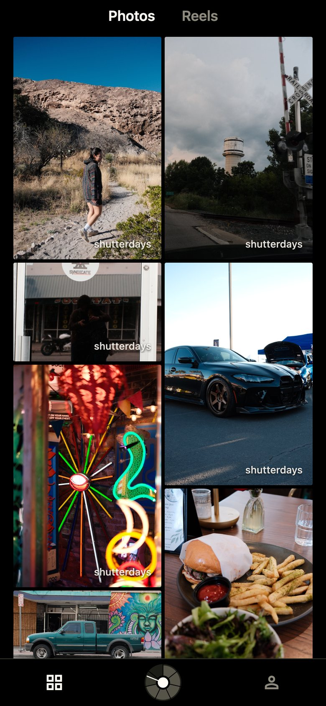
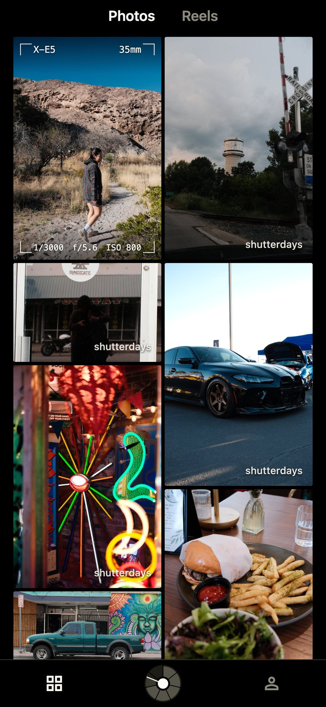
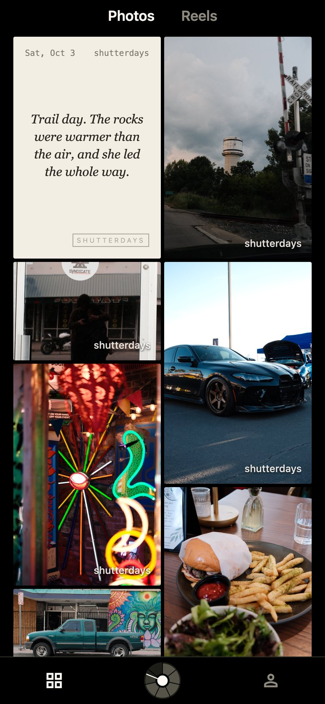
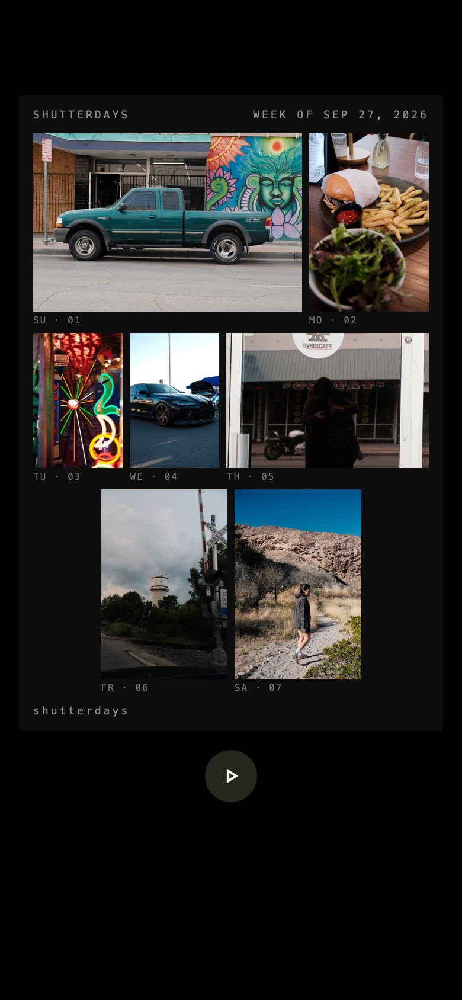
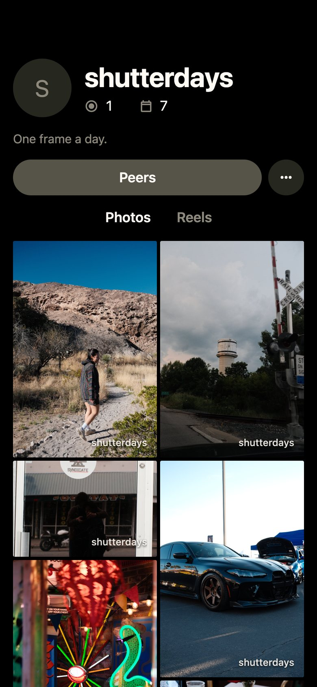

# Shutterdays

**One frame a day.**

Shutterdays is a photo journal for still photos only. Post one photo a day, Sunday to Saturday. Every frame counts the same: a desk, a coffee, a run, a storm rolling in. Finish all seven and your week develops into a reel.

The app is in testing with a small group on iPhone and Android. This repository holds the public website: [shutterdaysdev.tech](https://shutterdaysdev.tech), including the [privacy policy](https://shutterdaysdev.tech/privacy/). The app's code is private.

## How it works

|                                        The feed                                        |                           Tap: the viewfinder                            |                     Hold: the postcard                     |
| :------------------------------------------------------------------------------------: | :----------------------------------------------------------------------: | :--------------------------------------------------------: |
|                                      |    |  |
| Peers first, then people you follow, then everyone else. Photos keep their true shape. | Camera, focal length, shutter, aperture and ISO along the photo's edges. |         Turn a photo over to read its field note.          |

|                                                Seven days, one reel                                                 |                       Your profile                       |                       No passwords                       |
| :-----------------------------------------------------------------------------------------------------------------: | :------------------------------------------------------: | :------------------------------------------------------: |
|                                                     |  |  |
| A full week develops into a dated contact sheet that plays frame by frame. Each week's border design is a surprise. |     Photos, reels, weeks completed and days posted.      |     Sign in with a 6-digit code sent to your email.      |

## What we won't do

- **No video and no short-form feed.** Still photos only.
- **No follower counts**, anywhere.
- **No public likes.** A double-tap gives an award, and only the photo's owner sees the count.
- **No engagement ranking.** People you know first, newest first.
- **No punishment.** Miss a day and that week's reel doesn't develop, but your photos stay.
- **No location.** GPS is removed from every photo before it leaves the phone.

## Privacy and support

- [Privacy policy](https://shutterdaysdev.tech/privacy/) (source: [privacy/index.html](privacy/index.html))
- Support and feedback: [hernandezj@shutterdaysdev.tech](mailto:hernandezj@shutterdaysdev.tech)
- Delete your account any time in the app: Settings → Delete account.
